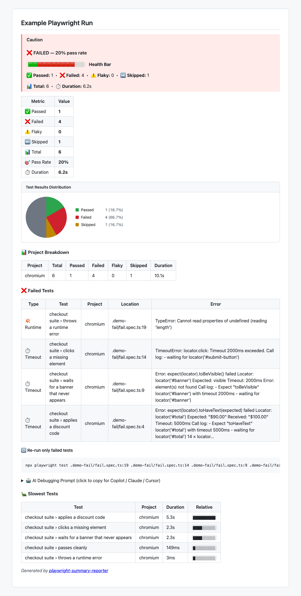
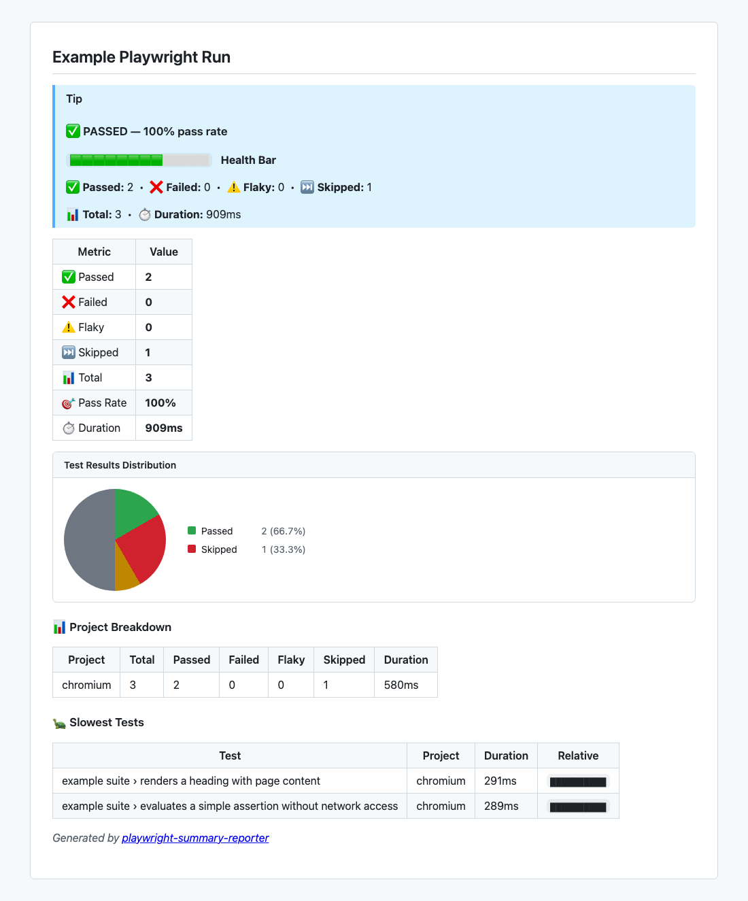
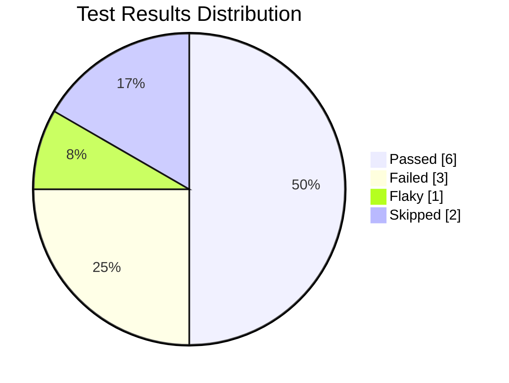

# playwright-summary-reporter

[](https://www.npmjs.com/package/playwright-summary-reporter)
[](https://www.npmjs.com/package/playwright-summary-reporter)
[](https://github.com/salekinnewaz/playwright-summary-reporter/actions/workflows/ci.yml)
[](LICENSE)

A zero-dependency Playwright custom reporter that turns your test run into a **beautiful Markdown dashboard** — locally and straight into the GitHub Actions Job Summary tab.

## Key Features

- 🎨 **GitHub-Flavored Alert Card** — a green `> [!TIP]` for a clean run, a red `> [!CAUTION]` otherwise, with status, pass rate and the full breakdown.
- 🟩🟥🟨⬜ **Proportional health bar** — a 12-block Unicode bar that visualises the result mix at a glance.
- 📊 **KPI summary table** — bold, high-contrast numbers for every headline metric.
- 🥧 **Native Mermaid pie chart** — a *Test Results Distribution* chart rendered by GitHub itself.
- 🎯🔍💥⏱️ **Deterministic failure badges** — every failure classified as Assertion, Timeout, Locator or Runtime.
- 🔁 **Copy-ready re-run command** — `npx playwright test <file>:<line>` for exactly the failed tests.
- 🤖 **AI debugging prompt** — a collapsible accordion bundling every failure for Copilot / Claude / Cursor.
- 📊 Per-project breakdown across browsers (`chromium`, `firefox`, `webkit`, …).
- ⚠️ Flaky test list with retry counts.
- 🐢 Top-N slowest tests with relative duration bars.
- 🔢 **Mathematically airtight totals** — `Total === Passed + Failed + Flaky + Skipped`, always.
- 🚀 Automatically appends to `GITHUB_STEP_SUMMARY` — no extra workflow wiring needed.
- 📦 Zero runtime dependencies — only Node.js built-ins (`fs`, `path`).
- 🔒 Retries are counted once, using the test's final outcome.
- 🧩 Ships TypeScript declarations (`dist/index.d.ts`).

## Installation

```bash
npm install -D playwright-summary-reporter
```

Requires Node.js 18+ and `@playwright/test` `>=1.40.0` (peer dependency).

## Quick Start

```ts
// playwright.config.ts
import { defineConfig } from '@playwright/test';

export default defineConfig({
  reporter: [
    ['list'],
    ['playwright-summary-reporter', { outputFile: 'test-summary.md' }],
  ],
});
```

Running `npx playwright test` now writes `test-summary.md` in your project root.

You can also point Playwright at the compiled file directly:

```ts
reporter: [['./dist/index.js', { outputFile: 'test-summary.md' }]]
```

## Options Reference

| Option | Type | Default | Description |
| --- | --- | --- | --- |
| `outputFile` | `string` | `'playwright-summary.md'` | Path of the Markdown file to write. Parent directories are created automatically. |
| `title` | `string` | `'Playwright Test Summary'` | Heading rendered at the top of the report. |
| `writeToGitHubSummary` | `boolean` | `true` | Append the report to `GITHUB_STEP_SUMMARY` when the env var is set. |
| `showFailedTests` | `boolean` | `true` | Render the *Failed Tests* table (only when failures exist). |
| `showFlakyTests` | `boolean` | `true` | Render the *Flaky Tests* table (only when flaky tests exist). |
| `showSlowestTests` | `number` | `5` | Number of slowest tests to list. Set to `0` to disable the section. |
| `maxErrorLength` | `number` | `250` | Maximum length of an error message before truncation. |
| `includeProjectBreakdown` | `boolean` | `true` | Render the per-project breakdown table. |
| `includeChart` | `boolean` | `true` | Render the Mermaid *Test Results Distribution* pie chart. |
| `includeRerunCommand` | `boolean` | `true` | Render the copy-ready "re-run only failed tests" command block. |
| `includeAiPrompt` | `boolean` | `true` | Render the collapsible AI debugging prompt accordion. |
| `collapsibleDetails` | `boolean` | `false` | Wrap long sections (e.g. *Slowest Tests*) in `<details>` accordions. |

## GitHub Actions Integration

The reporter detects `GITHUB_STEP_SUMMARY` automatically, so a normal workflow is enough:

```yaml
name: Playwright Tests

on: [push, pull_request]

jobs:
  test:
    runs-on: ubuntu-latest
    steps:
      - uses: actions/checkout@v4
      - uses: actions/setup-node@v4
        with:
          node-version: 20
      - run: npm ci
      - run: npx playwright install --with-deps chromium
      - run: npx playwright test
```

The summary is rendered in the **Job Summary** section of the workflow run, and the Markdown
file is written to disk as usual.

To opt out of the GitHub append, pass `writeToGitHubSummary: false`.

## Sample Rendered Output

A failing run surfaces everything at a glance — red alert card, failure-type badges, the exact
`file:line` to re-run, and a ready-to-paste AI debugging prompt:



A fully passing run renders the same dashboard in green:



```markdown
## Playwright Test Summary

> [!CAUTION]
>
> ### ❌ FAILED — 60% pass rate
>
> `🟩🟩🟩🟩🟩🟩🟥🟥🟥🟨⬜⬜` &nbsp; **Health Bar**
>
> ✅ **Passed:** 6 &nbsp;•&nbsp; ❌ **Failed:** 3 &nbsp;•&nbsp; ⚠️ **Flaky:** 1 &nbsp;•&nbsp; ⏭️ **Skipped:** 2
>
> 📊 **Total:** 12 &nbsp;•&nbsp; ⏱️ **Duration:** 12.4s
>
> ⏱️ **Timed Out:** 1 (counted within Failed)

| Metric | Value |
| --- | --- |
| ✅ Passed | **6** |
| ❌ Failed | **3** |
| ⚠️ Flaky | **1** |
| ⏭️ Skipped | **2** |
| 📊 Total | **12** |
| 🎯 Pass Rate | **60%** |
| ⏱️ Duration | **12.4s** |



### 📊 Project Breakdown

| Project | Total | Passed | Failed | Flaky | Skipped | Duration |
| --- | --- | --- | --- | --- | --- | --- |
| chromium | 5 | 3 | 2 | 1 | 0 | 6.6s |
| firefox | 4 | 2 | 1 | 0 | 1 | 4.5s |
| webkit | 3 | 2 | 0 | 0 | 1 | 640ms |

### ❌ Failed Tests

| Type | Test | Project | Location | Error |
| --- | --- | --- | --- | --- |
| 🎯 Assertion | authentication › should reject invalid password | firefox | tests/auth/login.spec.ts:24 | Error: expect(received).toBe(expected) |
| ⏱️ Timeout | payment › should validate expired card | chromium | tests/payment/card.spec.ts:55 | Error: Test timeout of 5000ms exceeded. |

#### 🔁 Re-run only failed tests

```bash
npx playwright test tests/auth/login.spec.ts:24 tests/payment/card.spec.ts:55
```

<details>
<summary>🤖 AI Debugging Prompt (click to copy for Copilot / Claude / Cursor)</summary>

```text
You are triaging a failing Playwright test run ("Playwright Test Summary").
...
```

</details>

### ⚠️ Flaky Tests

| Test | Project | Retries | Duration | Location |
| --- | --- | --- | --- | --- |
| cart › should add item to basket | chromium | 1 | 2.4s | tests/cart/add.spec.ts:12 |

### 🐢 Slowest Tests

| Test | Project | Duration | Relative |
| --- | --- | --- | --- |
| authentication › should reject invalid password | firefox | 3.1s | `██████████` |
| cart › should add item to basket | chromium | 2.4s | `████████░░` |

_Generated by [playwright-summary-reporter](https://www.npmjs.com/package/playwright-summary-reporter)_
```

## Dashboard Options

The dashboard sections are individually toggleable:

```ts
// playwright.config.ts
import { defineConfig } from '@playwright/test';

export default defineConfig({
  reporter: [
    ['list'],
    [
      'playwright-summary-reporter',
      {
        outputFile: 'test-summary.md',
        title: 'Nightly Regression',
        includeChart: true,        // Mermaid pie chart
        includeRerunCommand: true, // copy-ready re-run block
        includeAiPrompt: true,     // AI debugging accordion
        collapsibleDetails: false, // wrap long sections in <details>
      },
    ],
  ],
});
```

## Total Consistency

A timeout is a **kind of failure**, not a separate bucket. The four result buckets are
mutually exclusive and collectively exhaustive, so this invariant always holds — in every
table, in the chart, and in the KPI strip:

```text
Total === Passed + Failed + Flaky + Skipped
```

Timeouts are still surfaced: as a `⏱️ Timeout` badge in the Failed Tests table, and as a
`Timed Out` line in the alert card. They are never double-counted.

## Author

**Md Salekin Newaz** — Senior Software QA Engineer, ISTQB®

- Portfolio: [https://salekin-dev.vercel.app](https://salekin-dev.vercel.app)
- GitHub: [https://github.com/salekinnewaz](https://github.com/salekinnewaz)
- LinkedIn: [https://www.linkedin.com/in/md-salekin-newaz](https://www.linkedin.com/in/md-salekin-newaz)

## License

[MIT](./LICENSE) © 2026 Md Salekin Newaz
